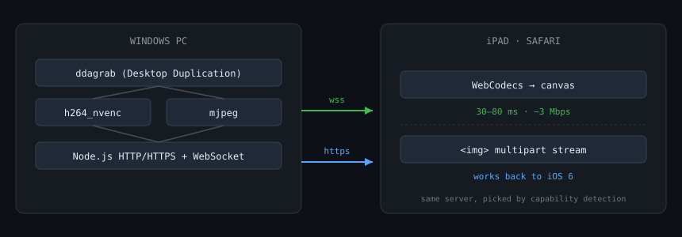

# ipad-second-screen

Turn an iPad — **including a 2015-era one stuck on iOS 9** — into a second
monitor for a Windows PC, using nothing but a browser on the tablet and
Node.js + ffmpeg on the PC.

No app store, no jailbreak, no developer account, no Cloud subscription.



## Why this exists

Windows has no Sidecar equivalent. Commercial tools (Duet, Luna, spacedesk)
usually need a native tablet app, an account, or both. This project goes the
other way: the tablet only ever opens a web page, so it works on hardware that
stopped receiving OS updates years ago.

It also turned out to be a decent exercise in encoding: the same server
speaks **two entirely different transport paths** depending on what the
browser can actually do.

## How it works

```
                Windows PC                                iPad
   ┌───────────────────────────────┐          ┌──────────────────────┐
   │ ddagrab (Desktop Duplication) │          │  Safari              │
   │          │                    │          │                      │
   │          ▼                    │          │  WebCodecs?          │
   │   h264_nvenc  ──▶ WebSocket ──┼── wss ──▶│   yes → VideoDecoder │
   │                               │          │   no  → MJPEG   │
   │   mjpeg ──────────────────────┼── https ─▶                      │
   └───────────────────────────────┘          └──────────────────────┘
```

* **Modern browsers** (iPadOS 16.4+, Chrome, Edge): NVENC encodes H.264 and
  streams raw Annex-B over a WebSocket; the page decodes it with WebCodecs and
  paints to a canvas. ~30–80 ms end-to-end, ~3 Mbps for a desktop.
* **Everything else**: a plain `multipart/x-mixed-replace` MJPEG stream that any
  browser back to iOS 6 can render. Higher bandwidth, higher latency, but it
  always works.

## Requirements

| | |
|---|---|
| PC | Windows 10/11, NVIDIA GPU for the fast path (any CPU works for MJPEG), Node.js 18+ |
| Tablet | Anything with a browser on the same LAN |
| Network | Wired PC + Wi-Fi tablet on the same subnet |

`ffmpeg` with `ddagrab` and `h264_nvenc` is required for the WebCodecs path.
Download a build from [gyan.dev](https://www.gyan.dev/ffmpeg/builds/) and put it
under `vendor/` (the server finds `ffmpeg.exe` recursively).

## Quick start

```powershell
# 1. dependencies
cd server
npm install

# 2. allow inbound traffic on 8080/8443 (one time, needs admin)
#    double-click 1-firewall.bat

# 3. start
#    double-click start.bat   — it prints a URL and a QR code
```

Then open `https://<pc-ip>:8443` on the tablet.

> **HTTPS is mandatory.** WebCodecs only exists in a secure context, so the MJPEG
> fallback would be the only option over plain HTTP.
>
> The certificate is self-signed. iOS will show a warning — tap
> **Show Details → visit this website**. The certificate is deliberately issued
> for **397 days**: Apple rejects TLS certificates valid for more than 825 days
> outright, with no way to bypass the warning.

## Second screen vs. mirror

By default the whole desktop is mirrored. For a real extended display you need
Windows to have a second monitor, which means a virtual display driver.

1. Install [Parsec VDD](https://builds.parsec.app/vdd/parsec-vdd-0.45.0.0.exe)
   (signed by Parsec Cloud, Inc.).
2. Add a display with [nomi-san/parsec-vdd](https://github.com/nomi-san/parsec-vdd)
   or the bundled helper scripts.
3. Put the virtual display at a 4:3 resolution matching the tablet
   (1600×1200 for a 2048×1536 panel) and set `outputIdx` in `server/config.json`
   to that output's index.

Then windows dragged to the right of the primary screen appear on the tablet,
and the mouse crosses over normally.

## Configuration

`server/config.json` (environment variables override it):

| key | default | meaning |
|---|---|---|
| `outputIdx` | `null` | `ddagrab` output index; `null` mirrors everything |
| `captureWidth` | `0` | width of the captured display |
| `fps` | `60` | capture frame rate (WebCodecs path) |
| `bitrateMbps` | `40` | bitrate **cap**, not a target |
| `quality` | `21` | NVENC `-cq`, lower is sharper |
| `preset` | `p6` | NVENC preset |
| `tune` | `hq` | NVENC tune |
| `mjpegMaxWidth` | `1280` | upper bound for the MJPEG downscale |
| `mjpeg.fps` | `20` | MJPEG frame rate |
| `mjpeg.quality` | `7` | MJPEG `-q:v`, higher is smaller/lossier |

The MJPEG path also accepts overrides in the URL, which is handy for tuning
from the tablet itself:

```
https://<pc-ip>:8443/?w=1024&q=7&fps=20
https://<pc-ip>:8443/?w=1280&q=6      # sharper, slower
https://<pc-ip>:8443/?fmt=avcc        # force AVCC framing
```

## Things that were not obvious

* **CBR wastes the entire budget on a still desktop.** NVENC pads constant
  bitrate with filler NALs — measured 35 Mbps of pure padding on an idle
  screen, versus 2.6 Mbps with `-rc vbr -cq 21`.
* **`tune=hq` beats `tune=ull` by ~6.5 dB PSNR** at the same `-cq`, for about
  1 Mbps more. On a desktop that is the difference between crisp text and
  mush.
* **Identical frames must not be re-sent.** At 12 fps a static screen burns the
  tablet's decoder for nothing; skipping duplicates dropped idle traffic from
  19 Mbps to 0.24 Mbps.
* **iOS 9 cannot parse modern JavaScript.** `async/await`, arrow functions and
  template literals make the whole `<script>` fail to parse, so the page loads
  and then silently does nothing. The client is therefore strictly ES5
  (validated with `acorn --ecma-version 5`).
* **`inset: 0` is Safari 14.1+.** On older WebKit it silently does nothing and
  your centered overlay ends up jammed in the top-left corner.

## Repository layout

```
client/index.html      ES5 client: WebCodecs + MJPEG fallback
server/server.js       HTTP/HTTPS, ffmpeg pipelines, WebSocket fan-out
server/config.json     runtime settings
server/test-client.js  headless stream check (no tablet needed)
server/capture-stream.js  dumps the stream to .h264 for offline validation
test/e2e.js            headless Chromium end-to-end
test/decoder-test.js   Annex-B/AVCC conversion + forced path
test/webkit-test.js    WebKit engine run (exercises the MJPEG fallback)
*.bat                  one-click launchers (ASCII only — see below)
```

> The `.bat` files contain **only ASCII**. A batch file with non-ASCII text plus
> `chcp 65001` desynchronises `cmd.exe`'s parser and every later line gets
> truncated, which looks like the window "flashing and closing".

## Troubleshooting

| symptom | cause |
|---|---|
| Page loads, nothing happens | certificate rejected (check validity ≤ 825 days) or JS parse error — open devtools or read the on-screen error line |
| "connection reset" in server log | client sent plain HTTP to the TLS port |
| Everything is black | no window has been moved to the virtual display yet |
| Laggy dragging | expected on old tablets; lower `w`/`fps` or use the WebCodecs path |

## Limitations

* No input forwarding — the tablet is read-only.
* Old iPads (iOS 9) have no hardware H.264 decode path in Safari, so MJPEG is
  the ceiling and the experience stays noticeably laggy for interactive work.
* No authentication: anyone on the LAN can view the screen after accepting the
  certificate. Home-network tool.

## 中文说明

把 iPad（包括停留在 iOS 9 的老设备）变成 Windows 副屏，平板端只用浏览器，
不需要装 App、不需要越狱、不需要开发者账号。

- **新设备**（iPadOS 16.4+）：NVENC 硬件编码 → WebSocket → WebCodecs 硬解，
  延迟 30~80ms，桌面约 3 Mbps
- **老设备**：自动降级为 MJPEG（`` 吃 multipart 流），兼容到 iOS 6

关键坑：自签证书有效期必须 ≤ 825 天（Apple 强制），否则 iOS 直接拒绝且不给
「继续访问」选项；老 iOS 的 JS 解析器不支持 `async/await`，整个页面会静默失效，
所以客户端严格用 ES5 写成。

## Credits

* [ffmpeg](https://ffmpeg.org/) — capture and encoding
* [Parsec VDD](https://builds.parsec.app/vdd/) — signed virtual display driver
* [nomi-san/parsec-vdd](https://github.com/nomi-san/parsec-vdd) — VDD control tools

## License

MIT — see [LICENSE](LICENSE).
